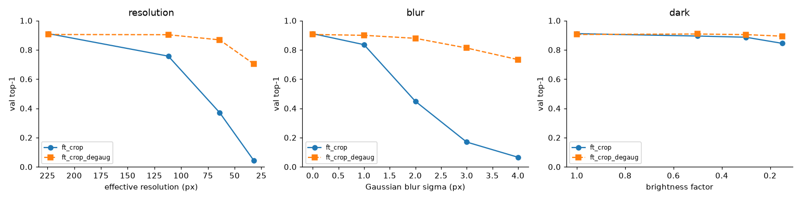
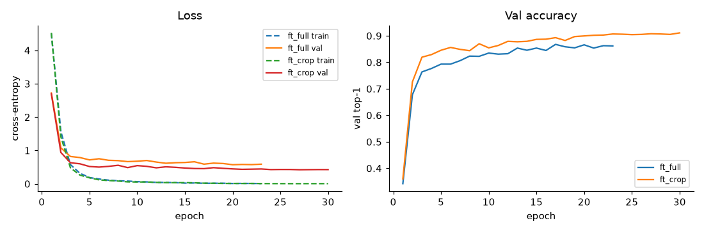
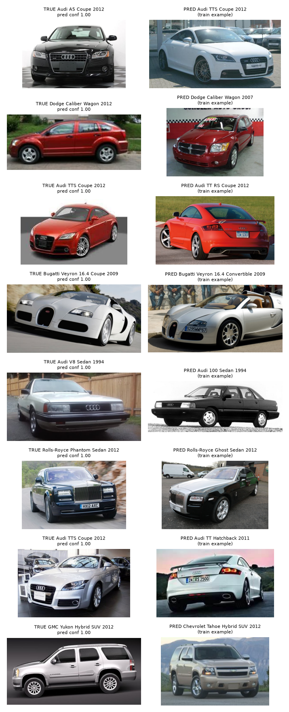
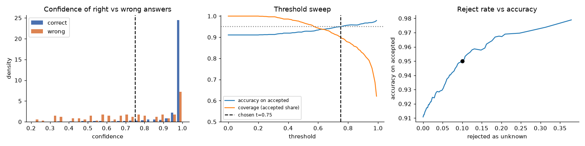
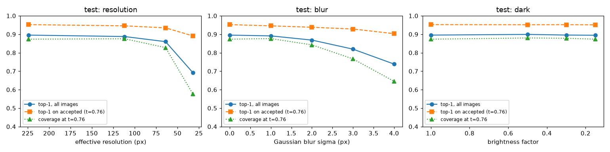

# Car Make and Model Classification (Stanford Cars)

A fine-grained image classifier for 196 car models, built to be explained, not just to score well. Every
setting was chosen on a validation split with a written reason ([docs/decisions.md](docs/decisions.md)), the
model says "unknown" when it is not confident enough, and its robustness to low resolution, blur, and
darkness was measured and then improved.

- **89.5% test top-1** on 196 classes
- **95.2% accuracy on accepted predictions** at 87% coverage (the rest are passed to a person as "unknown")
- **64 px accuracy improved from 37% to 87%** with degradation augmentation (val)



## Why this project

Visual inspection in manufacturing has the same core questions as this project: Can the model tell apart
things that look almost the same? When should it refuse to decide and pass the case to a person? How does it
behave when the camera image gets worse? How do you know the reported number is honest? Cars are a convenient,
public stand-in for that problem, and the dataset is hard enough that the answers are not obvious.

## Data

[Stanford Cars](https://www.kaggle.com/datasets/jutrera/stanford-car-dataset-by-classes-folder): 16,185 photos,
196 classes at make, model, and year level (for example "Audi S4 Sedan 2012"), with a bounding box for every car.

- The official train set (8,144) is split once, stratified by class, into **train 6,922** and **val 1,222**.
  The official **test set (8,041)** is used once, at the very end.
- Only 20 to 58 training images per class (median 36).
- Six makes hold 87 of the 196 classes (Chevrolet 22, Dodge 15, Audi 14, BMW 13, Ford 12, Hyundai 11), so many
  classes differ only in a trim badge, cab length, or model year.
- Cars are wide (median box 1.9:1) and cover about half of the image.

EDA is in [notebooks/01_eda.ipynb](notebooks/01_eda.ipynb) and uses the train split only.

## Method

1. **Baseline (feature extraction).** ImageNet-pretrained ResNet50, frozen. Its 2048-d features go into a
   logistic regression whose regularization is tuned on val.
2. **Fine-tuning.** The same ResNet50 with a new 196-class head, trained end to end with AdamW, a 10x higher
   learning rate for the head than for the backbone, warmup plus cosine decay, and early stopping on val. The
   learning rate was picked from a small sweep (3e-5, 1e-4, 3e-4).
3. **Input.** Each setting is run on the full image and on the bounding box crop (with a 10% margin). Images are
   resized straight to 224 x 224 instead of center cropped, so wide cars keep both ends.
4. **Confidence threshold.** If the top softmax probability is below a threshold, the answer is "unknown". The
   rule is the lowest threshold that gives at least 95% accuracy on accepted images on val.
5. **Robustness.** Accuracy is measured with images downscaled to 112, 64, and 32 px, blurred, and darkened. The
   best model is then retrained with random degradation augmentation and compared.

Why each value was chosen, and what else was considered, is written in [docs/decisions.md](docs/decisions.md).

## Results

### The 2x2 comparison (val top-1)

| | full image | bbox crop |
|---|---|---|
| frozen ResNet50 + logistic regression | 42.7% | 49.3% |
| fine-tuned ResNet50 | 86.7% | **91.1%** |

Fine-tuning is worth about 42 to 44 points: generic ImageNet features know "car" but not "2007 vs 2012 Caliber".
Cropping is worth another 4 to 7 points, because the car gets about twice as many pixels.



### Final model on the test set (evaluated once)

The final model is the bbox crop model trained with degradation augmentation, with threshold 0.76. Both were
fixed on val before the test set was opened.

| metric | val | test |
|---|---|---|
| top-1 | 90.5% | **89.5%** |
| top-5 | 98.6% | 98.4% |
| coverage at threshold 0.76 | 87.6% | 87.3% |
| accuracy on accepted images | 95.1% | **95.2%** |

The threshold chosen on val held almost exactly on test, which is the main sign that the selection process was
sound.

### Where the model fails



- 58% of val errors stay within the same make, against 4% if errors were random. The model gets the make right
  96% of the time and struggles with model, body style, and year inside a make.
- The most confused pairs are Audi V8 vs Audi 100 (1994), Dodge Caliber 2007 vs 2012, Ferrari 458 coupe vs
  convertible, and Audi 100 sedan vs wagon.
- Most "cross-make" errors are rebadged twins on the same body, such as Chevrolet Tahoe vs GMC Yukon,
  Chevrolet Express vs GMC Savana, and Dodge vs Mercedes-Benz Sprinter.
- Some mistakes have confidence near 1.0, so no threshold can catch them.

### Choosing the threshold



Raising the threshold trades coverage for accuracy. At 0.76 the model answers 87.6% of val images and is
right on 95.1% of them. The remaining 12% go to a person. The 95% target is a business choice. The same
procedure gives a stricter threshold if a wrong answer costs more.

### Robustness to degraded images

The figure at the top of this page shows the val curves.

| val top-1 | 224 px | 64 px | 32 px | blur 2 | blur 4 | brightness 0.15 |
|---|---|---|---|---|---|---|
| fine-tuned crop | 91.1% | 37.1% | 4.3% | 44.8% | 6.5% | 84.5% |
| + degradation augmentation | 90.5% | 86.8% | 70.3% | 87.9% | 73.3% | 89.4% |

Without augmentation the model collapses at 64 px and at moderate blur. Degradation augmentation costs 0.6
points on clean images and adds 32 points on average over the degraded conditions. On test, the final model
reaches 86.0% at 64 px and 69.2% at 32 px. As images get worse the model also rejects more of them, so the
accuracy on accepted images stays close to the target:



## Limitations

- **Clean photos and human boxes.** These are web photos with hand-drawn boxes. In real use a detector has to
  produce the crop, and its errors are not part of these numbers.
- **Old models and open set.** Most classes are 2012 or older. Many cars on the road today are not in the 196
  classes. The threshold turns some of them into "unknown", but open-set rejection was not measured directly,
  because no held-out set of unknown models was available.
- **Small validation set.** With 1,222 val images, one image is 0.08 points and differences under about 1
  point are noise. That is why 1e-4 and 3e-4 were treated as a tie.
- **Synthetic degradation.** Downscaling, blur, and darkening are simple stand-ins for real camera problems
  such as motion blur, compression, glare, and rain.
- **One backbone, one seed.** No EfficientNet or transformer comparison, and no repeat runs with other seeds.

## Reproduce

```bash
# 1. Environment (Python 3.13). RTX 50xx GPUs need the CUDA 12.8 build of PyTorch.
python -m venv .venv
.venv/Scripts/activate            # Windows; on macOS/Linux: source .venv/bin/activate
pip install torch==2.11.0 torchvision==0.26.0 --index-url https://download.pytorch.org/whl/cu128
pip install -r requirements.txt

# 2. Data: download from Kaggle and unzip into archive/
#    https://www.kaggle.com/datasets/jutrera/stanford-car-dataset-by-classes-folder
kaggle datasets download -d jutrera/stanford-car-dataset-by-classes-folder
unzip stanford-car-dataset-by-classes-folder.zip -d archive
#    Expected: archive/anno_train.csv, anno_test.csv, names.csv, car_data/car_data/{train,test}/

# 3. Fixed splits
python src/make_splits.py

# 4. Notebooks: EDA and the frozen baseline
jupyter nbconvert --to notebook --execute --inplace notebooks/01_eda.ipynb
jupyter nbconvert --to notebook --execute --inplace notebooks/02_baseline.ipynb

# 5. Learning rate sweep (6 runs, about 5 minutes each on an RTX 5070)
python src/sweep_lr.py
python src/promote_sweep.py       # copies the chosen runs (lr 1e-4) to outputs/ft_full and outputs/ft_crop

# 6. Degradation-augmented model
python src/train.py --run_name ft_crop_degaug --crop --degrade_aug

# 7. Analysis on val: 2x2 table, confusion, threshold, degradation, final choice
jupyter nbconvert --to notebook --execute --inplace notebooks/03_analysis.ipynb

# 8. The single test evaluation
python src/final_test.py
python src/plot_final.py
```

Every run writes its `config.json`, `train_log.csv`, metrics, and per-image predictions (top-5 with
probabilities) to `outputs/<run_name>/`. The seed is fixed at 42. GPU kernels are not bit-for-bit
deterministic, so a rerun can differ by an image or two.

## Project layout

```
src/
  config.py        paths, seed, hyperparameters
  make_splits.py   fixed train/val/test split
  dataset.py       loading, bbox crop, augmentation, degradation
  models.py        ResNet50 backbone and head
  train.py         fine-tuning loop with early stopping
  evaluate.py      predictions, metrics, degradation evaluation
  sweep_lr.py      learning rate sweep
  promote_sweep.py copy the chosen sweep runs to ft_full and ft_crop
  final_test.py    the one test evaluation
notebooks/         01 EDA, 02 baseline, 03 analysis
docs/decisions.md  every decision with alternatives and reasons
docs/figures/      figures used here
splits/            the fixed split files
```
